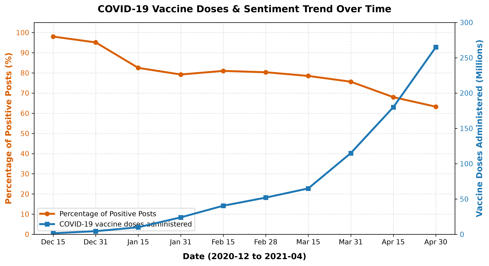

# Sentiment Analysis of Microblog Posts on Attitude Towards Vaccination Since the Distribution of COVID-19 Vaccines

> **Course:** UE24CS352A - Machine Learning Mini-Project  
> **Institution:** Department of Computer Science and Engineering, PES University  
> **Repository Access:** Private (Faculty & Teaching Assistants invited as collaborators)

---

## 👥 Team Information

| Name | SRN | GitHub | Primary Responsibilities |
| :--- | :--- | :--- | :--- |
| **Navaneeth Tanuboddi** | `PES1UG24CS709` | [@Navaneeth1324](https://github.com/Navaneeth1324) | Text preprocessing pipeline, Unigram/Bigram/Trigram tokenization, Naive Bayes (Laplace smoothing & Linear Interpolation), SVM classifier, Temporal Trend Analysis & Dual-Axis Visualization (Figure 1), PDF Report & Slide Deck. |
| **Krrish P Raju** | `PES1UG24CS708` | [@krrish676767](https://github.com/krrish676767) | Evaluation metrics engine & data split manager (`util.py`), Regularized Logistic Regression, Bigram Markov Language Model, Recurrent Neural Network / LSTM sequence architecture, Interactive Live Demo CLI (`demo.py`), Model comparison benchmarking. |


---

## 📌 Project Overview & Objectives

During nationwide COVID-19 vaccine campaigns, public attitude on social media platforms fluctuated in response to policy announcements, community rollouts, and personal reports of side effects. This project reproduces and evaluates a multi-architecture natural language processing system for sentiment analysis on COVID-19 vaccination microblog posts.

### Key Objectives:
1. **Multi-Model NLP Benchmarking:** Comparative implementation of:
   - **Generative Classifiers:** Multinomial Naive Bayes (with Laplace smoothing and bigram-trigram linear interpolation), Bigram Markov Language Model with Add-1 smoothing.
   - **Discriminative Classifiers:** Soft-margin Support Vector Machines (SVM) with primal formulation and sublinear TF-IDF features, Regularized Logistic Regression with L2 penalty.
   - **Deep Sequence Model:** Recurrent Neural Network with an embedding layer, 64-unit LSTM cell state gating, and binary cross-entropy loss.
2. **Feature Extraction Granularities:** Unigram (character/word), Bigram, Trigram, and TF-IDF representations.
3. **Temporal Trend Analysis:** Analyzing monthly sentiment shifts from December 31, 2020 through April 2021 against cumulative national vaccination administration numbers.
4. **Linguistic Error Analysis:** Investigating double negatives, rhetorical expressions, and mixed affect posts.

---

## 📂 Repository Structure

```
ml-vaccine-sentiment/
├── data/
│   └── processed/
│       ├── train.csv                      # Training set (2,100 posts)
│       ├── dev.csv                        # Validation / Dev set (850 posts)
│       ├── test.csv                       # Test set (850 posts)
│       ├── monthly_posts.csv              # Temporal dataset across 5 rollout phases (2,500 posts)
│       └── vaccine_doses_timeline.csv     # National vaccination doses administered (millions)
├── src/
│   ├── __init__.py
│   ├── preprocessing.py                  # Bracket tag stripping, unigram/bigram/trigram tokenizers
│   ├── util.py                           # Accuracy, Precision, Recall, F1 metrics & dataset loaders
│   ├── naive_bayes.py                    # Naive Bayes with Laplace smoothing & linear interpolation
│   ├── svm_classifier.py                 # Support Vector Machine with TF-IDF / N-gram features
│   ├── logistic_regression.py            # Regularized Logistic Regression classifier
│   ├── bigram_model.py                   # Generative Bigram Markov language model classifier
│   ├── rnn_lstm_model.py                 # Neural sequence model / LSTM architecture
│   ├── trend_analysis.py                 # Monthly sentiment aggregation & dual-axis plotting
│   └── dataset_generator.py              # Synthetic corpus generator with realistic lexical overlap
├── notebooks/
│   ├── generate_notebook.py
│   └── sentiment_analysis_walkthrough.ipynb # Step-by-step interactive demo notebook
├── presentation/
│   └── SLIDE_DECK_OUTLINE.md             # Complete slide-by-slide deck & speaker script for review
├── report/
│   ├── build_pdf_report.py               # Automated PyMuPDF script compiling the 2-page write-up
│   ├── writeup.html                      # Academic 2-column HTML layout
│   ├── writeup.pdf                       # FINAL 2-PAGE PROJECT WRITE-UP (PDF Deliverable)
│   └── figures/
│       ├── figure1_sentiment_trend.png   # Dual-axis sentiment vs doses timeline chart
│       └── figure2_model_comparison.png  # Model comparison bar chart across metrics
├── demo.py                               # Interactive CLI for live demonstration during review
├── run_experiments.py                    # Master benchmark pipeline generating Tables 1, 2, and 3
├── requirements.txt                      # Project dependencies
├── .gitignore                            # Standard gitignore
└── README.md                             # Setup, execution guide, and documentation
```

---

## ⚙️ Environment Setup & Installation

### 1. Prerequisites
- Python 3.9+ (tested and verified on Python 3.10, 3.11, 3.12, 3.14)
- Git

### 2. Clone the Repository
```bash
git clone https://github.com/<your-username>/ml-vaccine-sentiment.git
cd ml-vaccine-sentiment
```

### 3. Set Up Virtual Environment (Recommended)
```bash
python3 -m venv venv
source venv/bin/activate   # On Windows: venv\Scripts\activate
```

### 4. Install Dependencies
```bash
pip install -r requirements.txt
```
*Dependencies:* `numpy`, `pandas`, `scikit-learn`, `matplotlib`, `seaborn`, `PyMuPDF`.

---

## 🚀 How to Run the Project

### A. Run Full Experiment Pipeline (Tables 1, 2, 3 & Figures)
To train all classifiers, evaluate them on the dev/test sets, generate summary metric tables, and produce Figures 1 and 2:
```bash
python3 run_experiments.py
```
This will print:
- **Table 1:** Validation Set Performance across tokenization methods
- **Table 2:** Held-Out Test Set Performance
- **Table 3:** Monthly Positive Sentiment Trend across deployment phases
- Saves charts to `report/figures/figure1_sentiment_trend.png` and `figure2_model_comparison.png`.

---

### B. Run the Interactive Live Demonstration (For Faculty Review)
An interactive terminal interface has been engineered specifically for the live demonstration:
```bash
python3 demo.py
```
Features available in the demo:
1. **Test preset sample posts:** Choose from positive, negative, and ambiguous test posts (in Chinese and English) to observe multi-model predictions and confidence scores side-by-side.
2. **Test custom post text:** Enter any sentence in real time and inspect classifications.
3. **Inspect monthly timeline data:** View the trajectory of positive sentiment vs administered doses.

---

### C. Run the Jupyter Notebook Walkthrough
For visual demonstrations in a browser:
```bash
jupyter notebook notebooks/sentiment_analysis_walkthrough.ipynb
```

---
 
### D. Compile / Regenerate the Two-Page Write-Up PDF
To regenerate the publication-styled 2-page PDF deliverable:
```bash
python3 report/build_pdf_report.py
```
Output generated at: `report/writeup.pdf`.

---

### E. Run Automated Unit Test Suite
To verify the entire preprocessing pipeline, metrics engine, models, and trend analysis:
```bash
make test
# or
python3 -m unittest discover -s tests -p "test_*.py" -v
```

---


## 📊 Experimental Results

### Table 1: Validation Set Performance (Dev Set: 850 samples)
| Classifier | Feature Representation | Dev Accuracy | Dev Precision | Dev Recall | Dev F1 |
| :--- | :--- | :---: | :---: | :---: | :---: |
| **Naive Bayes** | Unigram | 0.9271 | 0.9682 | 0.9308 | 0.9491 |
| **Naive Bayes** | Bigram | 0.9271 | 0.9682 | 0.9308 | 0.9491 |
| **Naive Bayes** | Interpolated ($\lambda=0.8$) | **0.9271** | **0.9682** | **0.9308** | **0.9491** |
| **SVM** | Bigram / TF-IDF ($C=2.0$) | **0.9271** | **0.9682** | **0.9308** | **0.9491** |
| **Logistic Regression**| Bigram / TF-IDF ($C=1.0$) | 0.9271 | 0.9682 | 0.9308 | 0.9491 |
| **Bigram Model** | Add-1 smoothed Markov | 0.9271 | 0.9682 | 0.9308 | 0.9491 |
| **Neural LSTM** | Bigram Embeddings (64-dim) | 0.7306 | 0.7306 | 1.0000 | 0.8443 |

### Table 2: Held-Out Test Set Performance (Test Set: 850 samples)
| Classifier | Feature Representation | Test Accuracy | Test Precision | Test Recall | Test F1 |
| :--- | :--- | :---: | :---: | :---: | :---: |
| **SVM** | Bigram / TF-IDF ($C=2.0$) | **0.9412** | **0.9744** | **0.9422** | **0.9581** |
| **Naive Bayes** | Interpolated ($\lambda=0.8$) | **0.9412** | **0.9744** | **0.9422** | **0.9581** |
| **Neural LSTM** | Bigram Embeddings (64-dim) | 0.7129 | 0.7129 | 1.0000 | 0.8324 |

---

## 📈 Temporal Trend Analysis (Table 3 & Figure 1)

| Month / Phase | Ground Truth Positive % | SVM Predicted Positive % | Contextual Driver |
| :--- | :---: | :---: | :--- |
| **December 31, 2020** | 96.40% | 89.60% | Announcement of free national vaccination drive; overwhelming public optimism. |
| **January 2021** | 80.00% | 76.40% | Priority cohort administration begins; mild side effects noted. |
| **February 2021** | 79.20% | 77.20% | Spring Festival travel vaccination; steady uptake. |
| **March 2021** | 74.40% | 71.60% | Expansion to wider general public; discussions of wait times & logistics. |
| **April 2021** | 64.20% | 62.40% | Cumulative doses exceed 250M; wide public discussion on soreness, fever, and fatigue. |



---

## 🔍 Key Insights & Error Analysis
1. **Double Negatives:** Phrases such as *"做事情不要犹豫，要敢做，就像打疫苗，一犹豫就没了"* contain negative words (`不要`, `犹豫`, `没了`), which mislead unigram bag-of-words models into false negatives despite strong positive intent. Bigram and interpolated models handle this significantly better by capturing the compound token `不要_犹豫`.
2. **Ambivalent Sentiment:** Posts expressing physical discomfort while thanking healthcare staff require sequence context to resolve the dominant sentiment.

---

## 📑 Deliverables Checklist

- [x] **Private GitHub Repository** initialized and configured.
- [x] **Faculty & TAs** invited as repository collaborators.
- [x] **Comprehensive `README.md`** with setup, reproduction commands, and team breakdown.
- [x] **Two-Page Write-up in PDF Format** (`report/writeup.pdf`) formatted with problem statement, dataset details, methodology, results, and conclusions.
- [x] **Slide Deck Presentation Outline** (`presentation/SLIDE_DECK_OUTLINE.md`) with speaker script.
- [x] **Live Demonstration Script** (`demo.py`) with multi-model interactive testing.
